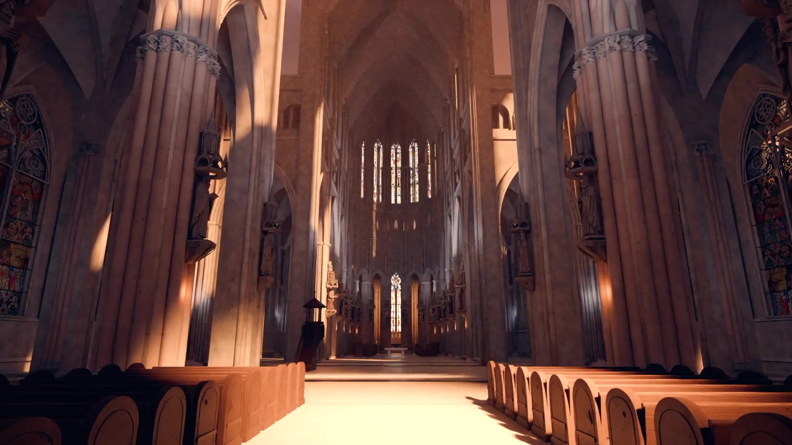

# 骨架规整草木野

分组：造型尺度 · 主维度：D 规则与有机、C 密度分区、E 表面差、A 光下细节、I 生长感 · 情绪：生机、时间

Blender 机场室内雨林 · 大网格天幕托住空间，下面林冠高低和疏密不一，水柱穿过两者。

| 参考 | 参考 |
|---|---|
|  |  |
| Athenaion · 水庭 · 圆亭和栏杆有确定边界，树冠与草簇越出边界但没有填平道路。 | Athenaion · Ruined portico · 残柱与梁仍可读为规整构架，杂草沿地面与断口生长。 |

## 一句话

把清楚的建筑骨架与不均匀生长的植物并置，让两种秩序互相说明。

## 看哪里

1. **Blender 机场室内雨林**：大网格天幕托住空间，下面林冠高低和疏密不一，水柱穿过两者。
2. **Athenaion · 水庭**：圆亭和栏杆有确定边界，树冠与草簇越出边界但没有填平道路。
3. **Athenaion · Ruined portico**：残柱与梁仍可读为规整构架，杂草沿地面与断口生长。

## 拆解

比例为原图目估区间，不是相机实参或场景米制测量；位置用归一化画幅描述。

- **D · 两种秩序**：图1顶棚网格集中上半部，林冠团块集中下半部；图2圆亭与水平栏杆是稳定骨架，树冠高低不齐。不能让植物也排列成同尺寸方格。
- **C · 密度分区**：图2水面集中左下（约x=0–45%、y=70–100%），圆亭后方中部的细柏密集，右上垂藤与前景叶片则局部越过石构边界；并非“中心空、边缘密”。图3中部开口仍能穿视。建议冠幅3档、疏密2档，不代表原作树种计数。
- **E · 频率差**：图3柱梁大面宽约画宽5–10%，叶与草主要是小于1–2%的碎边；草木细节不能切碎每一根柱子的整条轮廓。
- **A · 亮面留白**：图1亮天幕不爆成白板，图3亮柱面留有连续裸石；inside终止藤蔓是一种已核实的控制方法，不是所有作品共有算法。
- **I · 成因不同**：图3草沿地缝和断口，图1雨林被建筑有意容纳。维护中的室内林园与荒废遗迹不能都写成“无人管理”。

## 做法

先验收无植物的骨架，再分别放林冠、地被、缝隙草与藤蔓。完整树冠路线与局部草簇路线分开索引：树冠要成链集成VegSystem/树种库/材质/LOD，局部草可优先复用Citadel已移植版本。foliage减量器不是生成器。

### 实现索引

路径相对 `~/Blog/`；citadel 栏相对 `~/Blog/citadel/`。源码默认值不是旧截图的已验证运行实参；建议迁移值仍需目标场景实看。`source: none` 不以邻接源冒充原作算法。

| 作品 | 源码 / 技术与边界 | 参数及性质 | 许可 / 复用 | citadel 已有实现 |
|---|---|---|---|---|
| Blender 机场室内雨林 | `none`；原作源码与林冠资产未取得；最近邻接 Repos/athenaion/src/modules/vegetation.js:27-35 调 VegSystem→buildLibrary→scatterWorld→finalize；Repos/athenaion/src/vegetation/library.js:9-53 含 broad/pine/olive 等真树冠与LOD，不再用小草冒充森林。依赖 instances.js、trees.js、atlas/叶材质、wind/LOD钩子和 terrain/footprints，必须成链集成；不提供机场网格屋顶。 | 邻接 broadleaf LOD=[100,40,10] px（源码）；冠幅档位=至少3种（建议迁移值） | 原视频许可未明；邻接 MIT / reference | `lab/src/scenes/Shrine/canopy.js:18-67,97-130; lab/src/scenes/Shrine/index.js:161-186` |
| Athenaion · 水庭 | `Repos/athenaion/src/vegetation/scatter.js:266-307; Repos/athenaion/src/modules/flora.js:640-678`；已定位shot2：hero按相机射线寻找地面并投影冠顶，303-307行在圆亭后安置cypress及olive；flora662-663为shot2岸台地被。虚拟设计画幅1672×941，不是1920成片像素实测。需要 vegetation.js/library.js 的树种库、VegSystem与terrain/sets/footprints；不等于残廊草缝算法。 | shot2 olive scale=sMin .6 / sMax 1.7（源码）；shot2 olive width=1.45（源码）；shot2岸台 spacing=.42（源码） | MIT / integrate | `none` |
| Athenaion · Ruined portico | `Repos/athenaion/src/ruins/grass.js:8-98; Repos/athenaion/src/ruins/portico.js:185-244; Repos/athenaion/src/ruins/ivy.js:112-192; Repos/athenaion/src/ruins/ivy.js:196-252`；真实接口为 jointGrass(joints,opts)，内部 tuftGeometry()+grassMaterial()，没有tuftMesh。joints含p/t/len/patch/crack；依赖Three、proceduralMaterial/cached。portico以SDF、ground和inside约束growIvy，再由ivyMeshes输出茎/叶，依赖随机与大气材质；不是独立一函数可复制。 | jointGrass density=2.2簇/m（源码）；jointGrass size=[.06,.2]m（源码）；portico ivy=steps95 / step.045 / maxStems170（源码） | MIT / integrate | `lab/src/scenes/NeverlandRoom/moundDetail.js:28-56,81-96` |

## 迁移到博客

首选 `shrine-1` 鸟居与栏栅旁的分层林冠，不再用只有岩石/草簇的Neverland岩丘承接本卡。现成骨架在 `lab/src/scenes/Shrine/structures.js:155-183`（柱轴±1.1m、贯梁3.9m）与 `index.js:176-181` 的栏栅；植物不是待造：`canopy.js:32-65` 已按鸟居/殿堂位置放分叉树和远近林冠，`index.js:161-186` 实际调用两层。优先复用这套既有实现，不必先接Athenaion全套树库。

从现有 `ref` 与 `torii` 对照（`index.js:255-257`；torii position=[3.4,1.5,-5.2]、target=[2.6,2.6,-9.2]、FOV55°）。建议只调既有树spec的massProb/尺度与相邻留口：保留鸟居两柱和贯梁的连续轮廓，同时让一侧枝叶越出檐边；不要铺满同尺寸叶团。`canopy.js:97-130` 的屏幕WINDOWS、roofKeep与onStair排除应保留，它们保护天空、屋顶与后阶，不是可删的空洞。上述是源码确认的可测试落点，未声称本轮新拍或已移植验收。

Neverland的 `moundDetail.js:28-56,81-96` 只作已有局部草簇复用索引，不是本卡首选构图。搭配 `card:weathering-follows-form`、`card:terraces-carry-the-temple`；满屏粒子和密集HUD会与草木争高频。atlas/title不动。

## 反例

这张教堂画面有清楚的规整骨架，却没有植物层：画面两侧柱束和下部长椅连续重复，中央通道全程裸露。它能证明“骨架”不等于本卡的完整并置，不能拿来当草木疏密做坏的例子；这里不否定教堂本身的庄严感。

Blender cathedral interior · 只有规整石构与家具，无有机草木轮廓；采用已归档干净成片，未裁去UI、未修图。

[逐图来源与复现](SOURCE.md) · [返回视觉卡库](../../../README.md)
