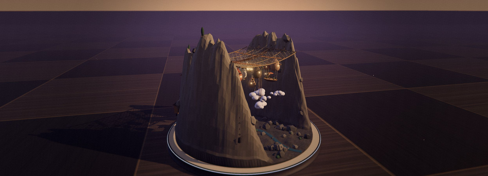

# 熟悉物标定巨构

分组：造型尺度 · 主维度：D 尺度参照、C 前中后景、A 轮廓、G 视点、I 世界观 · 情绪：宏大、敬畏

## 一句话

给巨物旁边放一个观众认识大小的东西，巨大才会从形容词变成直觉。

[Unreal 云上神殿与巨龙](https://skillry.dev/ai-videos/kimi-k3-1/kimi-moonshot-068067-1) · 近处巨龙、远处人物与右侧柱列共同给出尺度。

| 参考 | 参考 |
|---|---|
|  |  |
| [Athenaion · Panorama](https://github.com/Leonxlnx/athenaion) · 右侧神殿和巨像与左侧成片民居相比，宏大来自城市内的相对大小。 | [Blender 机场室内雨林](https://skillry.dev/ai-videos/kimi-k3-1/kimi-moonshot-068067-4) · 可识别的列车和树冠让屋盖的巨大变得可量，而不只是把镜头拉远。 |
## 看哪里

1. Unreal 云上神殿与巨龙：近处巨龙、远处人物与右侧柱列共同给出尺度。
2. Athenaion · Panorama：右侧神殿和巨像与左侧成片民居相比，宏大来自城市内的相对大小。
3. Blender 机场室内雨林：可识别的列车和树冠让屋盖的巨大变得可量，而不只是把镜头拉远。

## 一句话

让人物、窗格、列车或树冠承担尺子的作用，并保留它们与巨物之间的空间关系。

## 拆解

以下大小均为画面投影估计，不等于物理世界尺寸。

- **D · 尺度锚点**：龙殿人物高约画面21%，龙头加鬃角约占60%高，且龙身延伸出画面。可识别人形与未收全的龙轮廓一起使巨大成立；仅把龙放大但删掉人会弱化比较。
- **C · 空间关系**：Athenaion右侧神殿占幅约一半，左侧几十栋民居每栋只占约1–5%宽；台阶和树列把两种尺度连接，而不是把大楼与小房子随意拼在一起。
- **A · 轮廓识别**：龙背后暖云明亮、人物接近黑色，因此两个尺度参照都清晰。白鬃已有局部过曝，不能把更强的发光当作更大的体量。
- **G · 视点**：机场机位在室内向屋盖看，可见地面交通尺度；Athenaion是俯瞰城市，龙殿近似人物视点。同一语言可跨机位，关键不是一律超广角，而是保留已知参照。
- **I · 世界可用性**：民居的窗门、殿前台阶和机场交通线说明这些巨构有日常用途。它们使观众相信场景可居住，而不是单个展示模型。

## 做法

建模前先决定观众用什么估计尺度：在建筑场景里用门、台阶、灯具或车辆；角色层不允许3D化时，就用建筑内置的尺度物。

- **源码相机参照**：Athenaion全景采用FOV40°，pos=[108,66,30]，target=[15.1,61.5,-6.7]，见[作者相机列表](https://github.com/Leonxlnx/athenaion/blob/9b8bd23b39c458a50fb1201037360047781c45b5/src/world/shots.js)。不要把“巨构”简单等同于极低FOV或极广FOV。
- **迁移起点**：安排主巨构、中型功能建筑、小尺度门窗三档，投影高度先试约1 : 0.25 : 0.04；至少一种参照应无需文字说明就能识别。数字是构图草案，需在最终机位校准。
- 先看无纹理剪影，巨构应在400px缩图里仍能识别，参照物也不能小到完全消失。

### 实现索引

以下是源码阅读索引，不把邻接技术源说成原作实现，也不把现有基础组件说成整卡已落地。`Repos/` 相对 `~/Blog/`；`citadel` 列相对 `~/Blog/citadel/`。参数逐项标明来源，未做本轮运行测量。

| 作品 | 源码（本地路径:行） | 技术与接入边界 | 参数（来源） | 许可 / 复用档 | Citadel 已有可复用入口 |
|---|---|---|---|---|---|
| Unreal 云上神殿与巨龙 | `none` | 原作如何建模/渲染待验证；邻接技术源 Repos/athenaion/src/world/layout.js:73-110 用柱高、巨像、台阶建立统一尺度，可借这种关系，不等同复现巨龙或原作人物。 | 主巨构 / 中建筑 / 小门窗投影高度=1 : 0.25 : 0.04（建议迁移值） | 原作品源码及许可待验证；仅参考画面。邻接 Athenaion 源码为 MIT，不代表原作授权 / reference | `none` |
| Athenaion · Panorama | `Repos/athenaion/src/world/layout.js:73-110` | 用同一米制布局放置主殿、巨像与步级，再用斜俯视保留尺度关系；实际建殿入口 src/modules/temple.js:53-67，机位 src/world/shots.js:5-10。可移植布局和建造器，须连同依赖整理而非只抄尺寸。 | columnHeight=10.4（源码）；colossi heights=21 / 21 / 17（源码）；grand stair riser=0.23（源码）；panorama FOV=40°（源码） | MIT（LICENSE:1-21） / integrate | `none` |
| Blender 机场室内雨林 | `none` | 原作屋盖、列车与树木的建造源码未定位；邻接技术源 Repos/athenaion/src/world/layout.js:73-110 的巨构/巨像/步级尺度层级可迁移，但不提供机场或列车资产。 | 可辨认尺度锚点=至少 1 类门、车辆或树冠（建议迁移值） | 原作品源码及许可待验证；仅参考画面。邻接 Athenaion 源码为 MIT，不代表原作授权 / reference | `none` |

本批面向 CompanyMeetingroom 的门、窗、桌椅尺度锚点提案；尚未找到对应 cardfx 尺度模块，citadel=none 不表示要从零手写巨构。优先移植 Athenaion 布局/建造依赖或使用已有合规资产；不改 2D 人物体系。

源码快照（2026-10-28 阅读；不是新增截图来源）：
- `athenaion@9b8bd23b39c458a50fb1201037360047781c45b5`

已检索 `citadel/src` 及 `src/world/worlds/cardfx/`；本批未发现这些卡的同名预制模块。未来首次落地时才由执行者沉淀 `src/world/worlds/cardfx/scale-by-familiar-objects.js`，此处不是已有文件承诺。

## 迁移到博客

- **用在哪**：`src/world/worlds/atlas.js`的主地标；登记的BlackCityHall与Shrine会面背景。
- **改什么**：atlas地标以周围道路、低楼和窗格标定比例；房间景别用门高与台阶做参照。保留现有2D屏幕人物体系，不为复刻龙殿强行改成人物3D模型。
- **搭配**：柱廊节奏、前景遮挡、雾层纵深可进一步拉开距离。
- **冲突**：完整展台底座、网格地板和俯看小物件的镜头会把空间读成微缩模型；这可以是别的风格，但不承担本卡的沉浸巨构目标。

## 反例

Octavia图把山谷整体放在圆形底座上，外场地板网格比谷内房屋更醒目。虽然有大小对比，第一读法仍是“桌面摆件”。如果用于沉浸式巨构，需要在镜头内隐藏展台，并把尺度线索放回场景内部。

[Invisible Cities · Octavia](https://p.migdal.pl/invisible-cities-opus-5.5/?solo=octavia&view=side) · 完整底座和外场网格使观众读成桌面模型；不能直接当成身临其境的巨构镜头。

[逐图来源与复现](SOURCE.md) · [返回视觉卡库](../../../README.md)
