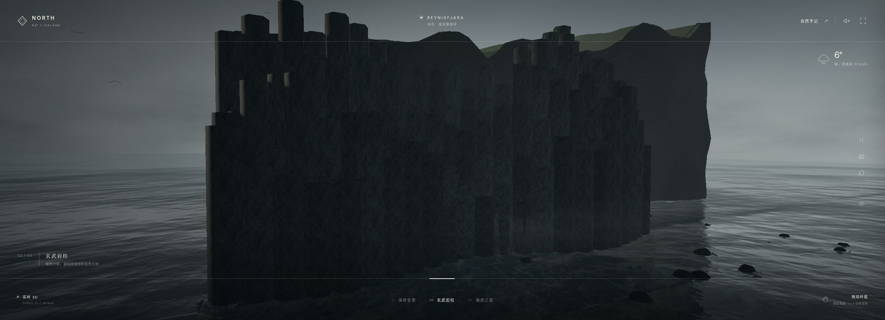

# 分级机位靠近

分组：镜头运动 · 主维度：G 视点与机位切换、C 前中后景、D 重复节奏、E 表面阅读、H 信息退场 · 情绪：肃穆、靠近

## 一句话

先交代海岸与目的地，再把相机交给柱壁，让近景回答远景留下的问题。

[雷尼斯黑沙滩 · 海滩](https://github.com/Zp-Peter/kimi-k31pro-opus55-benchmark-showcase/blob/65e82c53b63f2fdd918617269c057d8e53af2c6f/opus/reynisfjara/index.html) · 起点：近沙、左侧柱壁、右侧远礁同框，沿岸线先交代柱壁在海岸中的位置。

| 参考 | 参考 |
|---|---|
|  |  |
| [雷尼斯黑沙滩 · 柱壁](https://github.com/Zp-Peter/kimi-k31pro-opus55-benchmark-showcase/blob/65e82c53b63f2fdd918617269c057d8e53af2c6f/opus/reynisfjara/index.html) · 终点：正面柱壁横跨约80%画宽，柱头高低、横向断层和脚下碎石新增可读信息；整体仍偏暗。 | [黑沙之境 · 海岸全景](https://github.com/Zp-Peter/kimi-k31pro-opus55-benchmark-showcase/blob/65e82c53b63f2fdd918617269c057d8e53af2c6f/kimi/iceland-black-sand/dist/index.html) · 第三张总览旁证：海岸、远礁与右侧大壁的关系清楚；只支持起点的空间交代，不证明其近景细节。 |
## 看哪里

1. 图01左侧柱壁沿海岸延伸，右侧远礁建立距离，岸线把前景连接到目的地。
2. 图02正面细柱横跨约80%画宽；看中部密集柱头高低、横缝与底部散落碎石，近景新增的是组成关系。
3. 图03右壁、中央远礁与近沙清楚分层，只作总览旁证。它与图04反例构成另一作品的证据边界。

## 拆解

百分比为画面目估。图01→02的操作由上游记录实际观察，本次编辑逐张复核静帧；没有新录制连续运动，也不据静帧推断速度。

- **G · 视点**：主要正例由斜向海岸转到正面柱壁。不是简单放大同一张图，观看问题由“它在哪里”变为“它如何组成”。
- **C · 层次**：起点保留近沙、中壁、远礁；到达后允许远礁退出，底部碎石承接观众所在的地面。
- **D · 节奏**：终点的细柱高低不齐，中部密、两侧连入更大的岩层；比全景可读出更多横向断层。
- **E · 表面**：图02提供可读的分块与碎石，仍不足以当明亮材质特写。图04的大暗面没有同等新增信息，因此改列反例。
- **H · 退场**：Kimi一组确有大标题退场，但文字让位与表面质量是两项独立要求；前者成立不能替代后者。

## 做法

先构造两张各自成立的静态构图，再连接相机位置与注视目标。终点必须新增结构或材质信息。用400px缩略图确认大关系，再原尺寸检查表面；如果只能看出“物体变大”，先补终点而不是加转场。

Kimi实现只作为机位插值参考：全景position=(27,9.5,44)、target=(-9,4.8,-49)；近柱position=(26,12.5,-17)、target=(47,12,-61)。源码transition=2100ms，三次ease-in-out，位置和target共同插值；这是源码值，不是本轮实测时长，也不是该近景美术质量的证明。

源码：[两级机位](https://github.com/Zp-Peter/kimi-k31pro-opus55-benchmark-showcase/blob/65e82c53b63f2fdd918617269c057d8e53af2c6f/kimi/iceland-black-sand/src/iceland/main.js#L38-L49)；[位置与注视目标的过渡](https://github.com/Zp-Peter/kimi-k31pro-opus55-benchmark-showcase/blob/65e82c53b63f2fdd918617269c057d8e53af2c6f/kimi/iceland-black-sand/src/iceland/main.js#L159-L177)。只借思路，不复制未授权代码。

### 实现索引

2026-10-28 源码阅读补索引；不新增截图、不改上方视觉判断。上方“不能由截图推出/尚未审 shader”等界限指原视觉阶段，本节另列本批核过的源码。`Repos/` 相对 `~/Blog/`，Citadel 路径相对 `~/Blog/citadel/`。本批未运行这些源码测量参数，标为“源码”的值不得当作实测。

| 作品 | 源码（本地路径:行） | 技术与接入边界 | 参数（来源） | 许可 / 复用档 | Citadel 已有可复用入口 |
|---|---|---|---|---|---|
| 雷尼斯黑沙滩 · 海滩 → 柱壁 | `Repos/kimi-k31pro-opus55-benchmark-showcase/opus/reynisfjara/src/main.js:257-298` | goTo 先由地形求端点高度，再同时插值位置、target 和 FOV，并以正弦抬升避地；不是静态缩放。预设在 src/config.js:30-36。Citadel src/world/worlds/place.js:535-546,698-709 已有三者插值，但现为 0.9s cubic-out，未提供这套避地或两端停留。先用已有 goView 做 Platform/door-305 总览到细部，新增时长/停留需执行者显式实现并验证，不扩导航。 | source duration=2.8s（源码）；source path lift=sin(πk) * min(25, distance * 0.12)（源码）；citadel existing duration / easing=0.9s / cubic-out（源码）；migration segment / holds=2–3s / 两端各 1s（建议迁移值） | 未发现仓库根 LICENSE；作品代码授权待验证，只借手法，不复制代码/资产 / borrow | `src/world/worlds/place.js` |
| 黑沙之境 · 海岸全景 | `Repos/kimi-k31pro-opus55-benchmark-showcase/kimi/iceland-black-sand/src/iceland/main.js:38-49,137-182` | 同步插值 position/target，immediate 或 reduced-motion 时直达；只支持总览与技术路线，不把其暗柱近景重新列为美术正例。Citadel src/world/worlds/place.js:698-709 可复用插值，镜头安全/遮挡与减少动态分支仍须按当前场景验收。 | source transition / easing=2100ms / cubic ease-in-out（源码）；wide position / target=[27,9.5,44] / [-9,4.8,-49]（源码）；close position / target=[26,12.5,-17] / [47,12,-61]（源码） | 未发现仓库根 LICENSE；作品代码授权待验证，只借手法，不复制代码/资产 / borrow | `src/world/worlds/place.js` |

匹配表 Beyond Horizon 将本卡映射到 Metro/Platform 的导航语境；优先评估 platform-1 或 door-305 已有机位，不新增路线。先验两个静态端点，再验运动；安全、遮挡和 reduced-motion 行为独立验收。

源码快照（本批读取，不是新增截图来源）：
- `kimi-k31pro-opus55-benchmark-showcase@65e82c53b63f2fdd918617269c057d8e53af2c6f`

已检索 `citadel/src`（含 `src/world/worlds/`）与 `lab/src`；本批未发现 `src/world/worlds/cardfx/` 目录或本卡同名预制模块。以上入口只表示可复用部分；首次完整落地才由执行者沉淀 cardfx，不在此虚构文件。title / atlas locked，任何队列用途均不解除锁定。

## 迁移到博客

为BlackCityHall外廊提案“入口总览→登记门柱近景”；为Shrine提案“院落关系→门槛/灯”。先验近景新增信息，再决定是否连接动画，不据此恢复或新增导航路线。

迁移起点：2–3秒一段、两端各停1秒、只保留一个持续对象；均为建议值。先用粗模测遮挡，不能照搬原作坐标。

搭配柱廊明暗节奏与雾层纵深；避免同时转动场景、飞出标题和闪白，使空间连续性丢失。

## 反例

| 边界一：靠近却没有新增信息 | 边界二：终点仍是外部陈列 |
|---|---|
|  |  |
| 柱壁扩大到中央约55%画宽、标题退场，但大面接近同一暗值，竖棱与顶部高差不足以支撑高品质近景。 | 俯视展示完整底座，适合轻量产品陈列；若城门终点保持这种外部视角，仍像桌面摆件。此图是尺度对照，不是运动失败录像。 |

[逐图来源、链接与复现](SOURCE.md) · [返回视觉卡库](../../../README.md)
