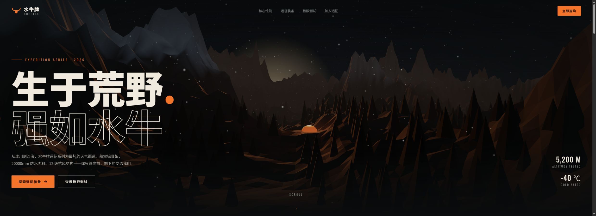

# HUD细线叠层

分组：排版 UI · 主维度：H 等宽与边栏、A 发光面积、B 状态色、C 中央主任务、G 状态变化 · 情绪：精密、警戒

## 一句话

让细线与数字提供秩序，中央留给目标；仅在事件发生时改变颜色和字级。

[KESTREL-9 · 扫描](https://vincentwei1021.github.io/mg-styles-15/#22-hud) · 中央球体与两边栏分工，线比面多，数字有三级亮度。

| 参考 | 参考 |
|---|---|
|  |  |
| [KESTREL-9 · 锁定](https://vincentwei1021.github.io/mg-styles-15/#22-hud) · 锁定时暖色横幅跨入中心，常驻数据主动变暗。 | [Warp Striker · 城市峡谷](https://github.com/OpenVGLab/awesome-opus5.5-frontend-showcases/blob/cac43b250f07b7b86f4709c61effc84269f46494/repro/warp-shooter/index.html) · 分数、时间、护盾沿边缘布置，中央仍是航道。 |
## 看哪里

1. KESTREL-9 · 扫描：中央球体与两边栏分工，线比面多，数字有三级亮度。
2. KESTREL-9 · 锁定：锁定时暖色横幅跨入中心，常驻数据主动变暗。
3. Warp Striker · 城市峡谷：分数、时间、护盾沿边缘布置，中央仍是航道。

## 拆解

百分比与颜色为画面目估，非渲染器测量。

- H：扫描页左右各约1/5宽边栏，等宽标签、小数字与主距离值分三级；装饰线条约1–3px观感，面板不靠磨砂玻璃块划区。
- A：扫描图约80%保持黑暗；光主要沿轮廓与文字，不能把每条分隔线都做成白色霓虹。
- B：扫描青色近#16DAD5，锁定阶段橙黄近#FFAD22（目估）；颜色承担“常态/事件”，不是多色永久混用。
- C：扫描圆直径约画高3/4，中心不放正文；Warp HUD把数字推向四角，中央航道保持连贯。
- G：实际看过扫描到锁定两个内容阶段，8.2s单帧明确显示状态改变；不据此编造准确变焦速度。事件条应短暂出现，结束后把中央还给目标。

## 做法

将常驻信息限制在周边栅格，用细线/角标代替有色卡片底；重点数字靠字号与明度区分。事件条独立于常态HUD。

迁移建议：普通线条1px、重点轮廓2px，常驻文字对比约主数值的40–65%；高饱和色只给当前状态。先做静态读数与空场景叠合测试，再加扫描动画。

本卡只给构图/排版迁移建议，不将未知源码值补成精确参数。

### 实现索引

以下是源码阅读索引，不把邻接技术源说成原作实现，也不把现有基础组件说成整卡已落地。`Repos/` 相对 `~/Blog/`；`citadel` 列相对 `~/Blog/citadel/`。参数逐项标明来源，未做本轮运行测量。

| 作品 | 源码（本地路径:行） | 技术与接入边界 | 参数（来源） | 许可 / 复用档 | Citadel 已有可复用入口 |
|---|---|---|---|---|---|
| KESTREL-9 · 扫描 / 锁定（同一作品） | `Repos/mg-styles-15/demos/22-hud/js/hud.js:1-141` | Canvas2D 用细线/角标/三级明度画周边仪表，独立文字上下文，按 BOOT/SEARCH/SIGNAL DETECTED/LOCKED 切信息层级；事件色另由同仓 demos/22-hud/js/post.js:42-55 按目标径向波将 HUD 重染色，保留指定青色/真红区域。移植绘制器需接 cues、进度和合成依赖，不能把线色常量当最终像素；Citadel 未发现同等扫描/锁定叠层，已有 src/ui/VerbHud.jsx:14-23 仅可借地点挂载/隐藏条件。 | stroke default width=1（1920×1080 设计画布单位）（源码）；frame corner width=1.5（源码）；frame margin=40（源码）；default text size=13（源码）；主/次/弱亮度层级=100 / 60 / 30%（源码注释设计层级）（源码） | MIT（LICENSE:1-21） / integrate | `none` |
| Warp Striker · 城市峡谷 | `Repos/awesome-opus5.5-frontend-showcases/repro/warp-shooter/index.html:23-57` | 绝对定位四角 HUD，用小标签/大数值和 1px 边框保留中央航道；src/hud.js:102-161 将游戏状态写入 DOM、将世界目标投影到屏幕，最多 6 个标记。仅移植边缘排版和状态绑定，不复制整套游戏 UI；原作 index.html:52 的仪表 #7a1d6b 紫渐变接近项目禁区，勿移植；Citadel 现有 src/ui/VerbHud.jsx:14-23 不是等价细线叠层。 | cell border=1px（源码）；horizontal edge offset=calc(var(--u) * 2.2)（源码）；label letter spacing=.28em（源码）；projected marker pool=6（源码） | MIT（LICENSE:1-21） / integrate | `none` |

队列落点为 platform-1 设备状态提案；新增 HUD 应复用 Place 现有挂载条件（src/ui/VerbHud.jsx:14-23），只显示有用状态，等宽字体沿项目已有资源。未确认等价 cardfx，citadel=none，不触碰锁定的 atlas/title。

源码快照（2026-10-28 阅读；不是新增截图来源）：
- `mg-styles-15@49052d80bfaf9fa8412cc9710530e5e95a3b8d8c`
- `awesome-opus5.5-frontend-showcases@cac43b250f07b7b86f4709c61effc84269f46494`

已检索 `citadel/src` 及 `src/world/worlds/cardfx/`；本批未发现这些卡的同名预制模块。未来首次落地时才由执行者沉淀 `src/world/worlds/cardfx/thin-line-hud.js`，此处不是已有文件承诺。

## 迁移到博客

用于现有atlas的地点选中状态，或登记场景Platform的设备叠层提案：加入边缘地点名、编号和状态。中心留给3D目标；BlackCityHall终端仅是新内容建议，不当作已存在功能。

沿现有内容选择3项有用数据，删除占位经纬度与无意义滚码；锁定态最多突出一条动作结果。MG可以提供2D层语言，但不是对整个博客复制雷达屏。

搭配低机位入场，保持消失点附近无常驻字；避免玻璃拟态、满屏彩色发光及巨字常驻。

## 反例

远征页的巨字适合广告标题，但若成为场景内常驻HUD，左山与中央小帐篷都会退成背景。问题在于信息权重不再服务场景，而非“字大”本身有错。

[水牛远征 · 大字与山谷](https://github.com/Zp-Peter/kimi-k31pro-opus55-benchmark-showcase/blob/65e82c53b63f2fdd918617269c057d8e53af2c6f/opus/buffalo/01-expedition.html) · 永久巨字和两个高对比按钮压过山谷与暖点目的地。

[逐图来源与复现](SOURCE.md) · [返回视觉卡库](../../../README.md)
