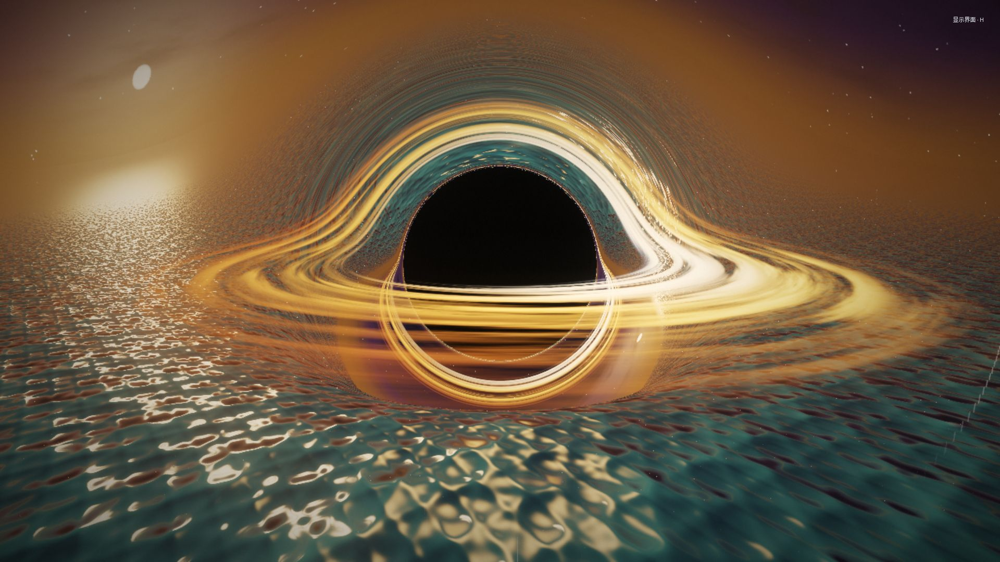

# 水面续轮廓

分组：水与大气 · 主维度：F 反射连续性、C 水平分界、D 形体重复、B 反射色、E 波面 · 情绪：安静、延展

## 一句话

让岸上形体在水里接着存在，倒影为建筑增加第二个向下延伸的空间。

[江南山谷 · 清晨河岸](https://github.com/holooooo/webgl-seascape-video/blob/915cb7c9a318e03bd2228bc232494b496ff2316c/episodes/04-jiangnan-voxel/interactive.html) · 桥洞与倒影接近闭合，两侧墙体沿岸线向下延伸。

| 参考 | 参考 |
|---|---|
|  |  |
| [清明上河 · 雨中虹桥](https://silentfleetkk.github.io/qingming-bianjing/opus-5.5/qingming-bianjing.html) · 船身和桅杆被波纹打碎，仍能对回水上的对象。 | [Falcon 9 · 海面降落](https://github.com/noahsabaj/falcon9-blender/releases/tag/v1.0) · 船舷与右侧箱体在水中延成倒形，左侧绿灯也有对应亮点；水纹只轻微打散它们。 |
## 看哪里

1. 江南山谷 · 清晨河岸：桥洞与倒影接近闭合，两侧墙体沿岸线向下延伸。
2. 清明上河 · 雨中虹桥：船身和桅杆被波纹打碎，仍能对回水上的对象。
3. Falcon 9 · 海面降落：船舷与右侧箱体在水中延成倒形，左侧绿灯也有对应亮点；水纹只轻微打散它们。

## 拆解

下列为截图观察，反射实现与准确roughness不由画面断言。

- **F · 连续性**：江南拱桥下半圆由水补完；雨桥的暖窗倒影仍处在窗下方，虽碎但方向正确。反射不是随意铺一张漂亮波纹。
- **C · 分界**：江南水岸约在画高中线下方，桥洞与对称倒影围成中心入口；Falcon船体接水线位于画面下部，水中箱体倒形由这条边界向下延伸。
- **D · 形体**：先反射大的墙、桥、船，再出现窗和枝条。雨船长暗形比小白波点更能说明水面位置。
- **B · 色彩**：雨景船窗浅米色在水中变暗、变碎；冷灰水底仍占多数面积。倒影不应比源物体更饱和或无缘由更亮。
- **E · 波面**：Falcon船体的大形较稳，雨桥船边更破碎；两者都保留低频轮廓，近处波纹才承担细节。真实折射、屏幕反射范围须另验。

## 做法

先用没有小波纹的水面验证对象与倒影的空间对应，之后逐级加入法线扰动。斜看角度下更强的表面反射可以与近处透水区域共存。

- **迁移试验值**：构图先给水面25–40%画高；选一个桥洞、灯柱或门洞作反射标尺。波纹加入后，400px缩图仍应认出至少一个成对轮廓。
- 若使用屏幕空间反射，必须实看相机移动时是否突然断掉；截图本身不能证明离屏反射正确。

### 实现索引

2026-10-28 已打开本地源码核对；当前 checkout 不等同旧成片版本。参数区分源码与建议迁移值，尚未在 Citadel 运行复刻。`citadel: none` 是尚未找到可复用实现，不是已落地声明。第三方路径相对 `~/Blog/`，Citadel 路径相对 `~/Blog/citadel/`。固定版本与许可见 [SOURCE.md](SOURCE.md)。

| 作品 | 源码 / 邻接与手法 | 参数及性质 | 许可 / 复用 | Citadel 可复用实现 |
|---|---|---|---|---|
| 江南山谷 · 清晨河岸 | `Repos/webgl-seascape-video/jiangnan/src/02_terrain.js:262-267,310-389`；Reflector 反射真实场景、Fresnel 混合深浅水底，法线小幅扰动反射UV；不用任意倒影贴图替代岸上对象 | clipBias=0.002（源码）；Fresnel F0=0.02（源码）；UV扰动系数=0.02（源码） | 无根 LICENSE / borrow | `src/world/worlds/planarWaterReflection.js:6-30,33-70` |
| 清明上河 · 雨中虹桥 | `Repos/qingming-bianjing/opus-5.5/qingming-bianjing.html:1088-1103`；由河道左右边界生成 Reflector 网格，水面 y=0；相机层选择反射对象，雨扰动在 WaterShader 中需同时接入 | WATER_Y=0（源码）；clipBias=0.002（源码） | 无根 LICENSE / borrow | `src/world/worlds/planarWaterReflection.js:6-30,33-70` |
| Falcon 9 · 海面降落 | `Repos/falcon9-blender/film/envs.py:231-254`；Blender 海面 Principled BSDF 低粗糙度+世界坐标噪声 bump；函数默认值非56s成片的已核实实参，WebGL用项目平面反射替代光追 | rough 默认=0.06（源码）；IOR=1.33（源码）；wave_bump 默认=0.25（源码） | 源码 MIT；模型/成片 CC BY-NC 4.0 / integrate | `src/world/worlds/planarWaterReflection.js:6-30,33-70` |

Citadel 复用接口：`createWaterReflection(gl, scene, seas)` 返回 render/dispose；seas 材质需含 `uReflection`、`uReflectionMatrix`，不是 Reflector 的 `tDiffuse/textureMatrix` 直接替换。仅水平水面；反射目标随模块 dispose。应逐个水面验证裁切与画质，不以有模块等于已复刻原作。

## 迁移到博客

Beach1/2已登记开放，其后续美术方案适合先做一个可读岸物与倒影组合；Shrine若加水庭，先让门柱或台阶反射成立，再添加漂浮花瓣。这里是新增方案，不表示已实现水庭。

搭配河道串景、镜面邻粗面；与强密集焦散、满水面白色高光冲突。反射负责形状，焦散只在浅水局部负责水底照明。

## 反例

Cosmos的水面高光与天体发光同时密集，虽然能读出水，却很难靠倒影延续主体。它适合躁动奇观，不适合本卡的安静空间延展。

[Shader & Cosmos · 吸积盘](https://github.com/holooooo/webgl-seascape-video) · 亮点覆盖大部分水面，很难用稳定倒影读出上方形体。

[逐图来源与复现](SOURCE.md) · [返回视觉卡库](../../../README.md)
