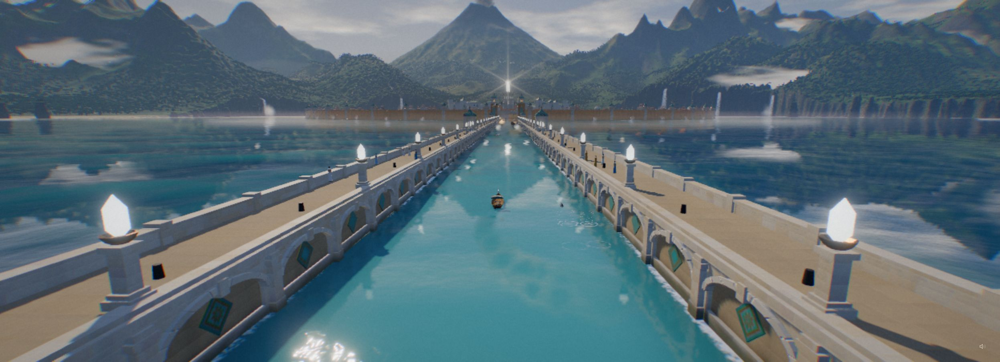

# 河道串景

> 已撤出正式卡库：修订一次后复核仍 FAIL。此文件保留当时未闭环内容，不可作为 card:river-leads-the-eye 实现索引引用；具体差距与重出条件见 [批次筛选表](../../cards-20261028-b3.csv)。

分组：构图重心 · 主维度：C 引导线、D 地标节奏、B 色块分区、F 水与岸、G 机位 · 情绪：开阔、悠远

## 一句话

用连续水道在密集场景里留出一条可读路径，把近景、中景与远处地标串起来。

[Poseidia · Sea Canal](https://poseidia.vercel.app/) · 两道栏桥把中央水道框成直轴，近晶灯、小舟、远殿各占一个尺度。

| 参考 | 参考 |
|---|---|
|  |  |
| [清明上河 · 黄昏全城](https://silentfleetkk.github.io/qingming-bianjing/opus-5.5/qingming-bianjing.html) · 斜河在密集屋顶中划开一条低细节通道，把桥放在两个岸区之间。 | [Sakura River Valley](https://valley.mengto.here.now/) · 河道从近船绕向远桥，山坡与岸草一起让出这条路径。 |

[江南山谷 · 清晨河岸](https://github.com/holooooo/webgl-seascape-video/blob/915cb7c9a318e03bd2228bc232494b496ff2316c/episodes/04-jiangnan-voxel/interactive.html) · 桥洞、两侧白墙和倒影一起围住河面的远端出口。
## 看哪里

1. Poseidia · Sea Canal：两道栏桥把中央水道框成直轴，近晶灯、小舟、远殿各占一个尺度。
2. 清明上河 · 黄昏全城：斜河在密集屋顶中划开一条低细节通道，把桥放在两个岸区之间。
3. Sakura River Valley：河道从近船绕向远桥，山坡与岸草一起让出这条路径。
4. 江南山谷 · 清晨河岸：桥洞、两侧白墙和倒影一起围住河面的远端出口。

## 拆解

位置与比例为截图估计。

- **C · 引导线**：汴河由右下宽处斜向左侧远处缩窄，中桥落在约(40%,62%)；Sakura河由前景宽水面收向右上桥塔；江南低机位的远端落在桥洞内。
- **D · 地标节奏**：近船、中桥、远塔承担不同距离。塔只占Sakura约画高25%，但轮廓高出林冠，不需要加一束夸张聚光来宣布焦点。
- **B · 大色块**：汴京屋顶是深棕密纹，河面是浅金低细节带；Sakura岸草暗绿、水面灰青。路径靠密度与明度分离，不依赖描边。
- **F · 岸与水**：水道两侧保留连续岸线，倒影在水面中断而非盖住岸线；江南拱桥的倒影补出圆形，仍把桥洞留为路径出口。
- **G · 视点**：高处看汴京读城市布局，贴水看江南读前进方向。先决定希望观众看地图还是进入场景，再选高度。

Poseidia辅图给出直轴变体：两侧拱孔与灯柱向约(51%,32%)的远殿收束，小舟宽约画宽1.5%用于标定水道；近灯白核略失细节、边缘色散较强，因此只借水道与尺度组织，不复制其后期强度。

## 做法

建模时先画一条大尺度的河形和两岸轮廓，把地标放在弯道、交叉桥或远端开口；最后再填房屋和草。

- **源码机位参照**：江南[四种相机](https://github.com/holooooo/webgl-seascape-video/blob/915cb7c9a318e03bd2228bc232494b496ff2316c/episodes/04-jiangnan-voxel/interactive.html#L3615-L3618)把全景与1.35高度河边机位分别定义；不靠一个镜头兼顾全部尺度。
- **迁移试验值**：主路径在近端可占画宽25–45%，到远端压缩到5–10%；路径内减少散落高亮道具，桥和塔分别承担中远两个锚点。

### 实现索引

2026-10-28 已打开本地源码核对；当前 checkout 不等同旧成片版本。参数区分源码与建议迁移值，尚未在 Citadel 运行复刻。`citadel: none` 是尚未找到可复用实现，不是已落地声明。第三方路径相对 `~/Blog/`，Citadel 路径相对 `~/Blog/citadel/`。固定版本与许可见 [SOURCE.md](SOURCE.md)。

| 作品 | 源码 / 邻接与手法 | 参数及性质 | 许可 / 复用 | Citadel 可复用实现 |
|---|---|---|---|---|
| 清明上河 · 黄昏全城 | `Repos/qingming-bianjing/opus-5.5/qingming-bianjing.html:809-829,1221-1231`；809–829 为 CatmullRom 中心线、法向和半河宽查询；1221–1231 的 occFree 对旋转建筑占地作 5×5 采样，1229 以 ri.d < ri.hw + 4 拒绝近岸建物。是采样式留白检查，非精确多边形排除；仅借布局逻辑，不复制整城。 | RIVER_N=1000（源码）；基础半河宽=17.5m（源码）；桥头收窄项=5m（源码）；岸边禁建余量=4 世界单位（源码）；建筑占地采样=5×5（源码） | 无根 LICENSE（Three vendor MIT 不覆盖作品） / borrow | `none` |
| Poseidia · Sea Canal | `none`；原作源码未取得；邻接技术源 Repos/qingming-bianjing/opus-5.5/qingming-bianjing.html:809-829,1221-1231（无根 LICENSE，只借手法）。以中心线与两岸禁建带保留直轴，近船/中桥/远殿由布局定位；不声称原作源码；不是原作实现证明，迁移待验证。 | 近端水道占宽=25–45%（建议迁移值） | 原作许可未明；邻接源许可见说明 / borrow | `none` |
| Sakura River Valley | `none`；原作源码未取得；邻接技术源 Repos/qingming-bianjing/opus-5.5/qingming-bianjing.html:809-829,1221-1231（无根 LICENSE，只借手法）。弯河中心线+地标锚点；原作行船与花瓣算法未知；不是原作实现证明，迁移待验证。 | 远端水道占宽=5–10%（建议迁移值） | 原作许可未明；邻接源许可见说明 / borrow | `none` |
| 江南山谷 · 清晨河岸 | `Repos/webgl-seascape-video/jiangnan/src/02_terrain.js:262-267,310-389`；水面网格以 terrainSample 水深裁掉干地三角形，岸墙/桥洞另属场景几何；这里只索引水岸交界，中心线路由参见汴京邻接源 | WATER_BOX=x[-48,60],z[-128,178]（源码）；水面网格步长=1m（源码） | 无根 LICENSE / borrow | `none` |

## 迁移到博客

Beach（`beach-1`）入口可用水口引向可交互地标，Shrine（`shrine-1`）水庭可用中桥定位；atlas 已锁定，不纳入施工。这是路线组织提案，不是复活已退役的旧海上进场路线。场景内传达方向即可，文字说明留给现有UI。

搭配水面续形、雾层显距离；与中央大字、满水面闪烁高光冲突。河道应先作为一个完整形状被读到，随后才看见波纹。

## 反例

Cosmos水面均匀铺满亮点，缺少能够穿过这些点的安静路径。类似的高频表面若用在河道，会让观众只看到“水特效”，丢失岸线和目的地。

[Shader & Cosmos · 吸积盘](https://github.com/holooooo/webgl-seascape-video) · 高频亮点铺满水面，缺少连续安静通道指向目的地。 仅评价本次画面。

[逐图来源与复现](SOURCE.md) · [返回视觉卡库](../../../README.md)
